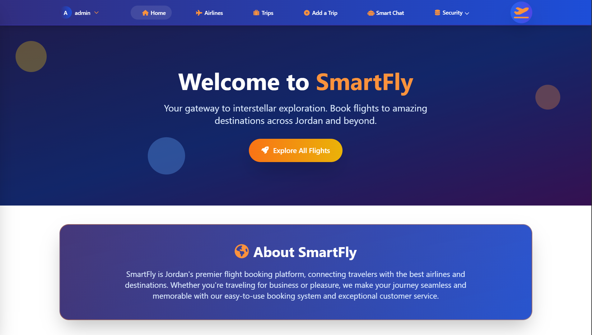
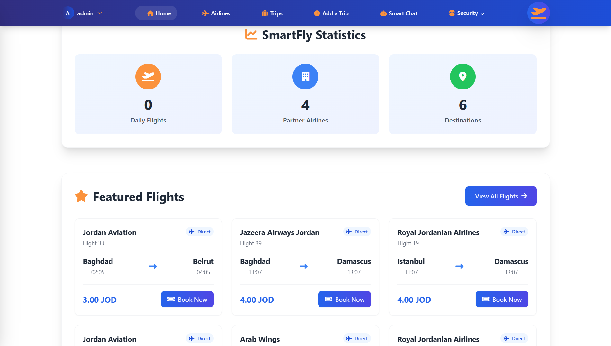
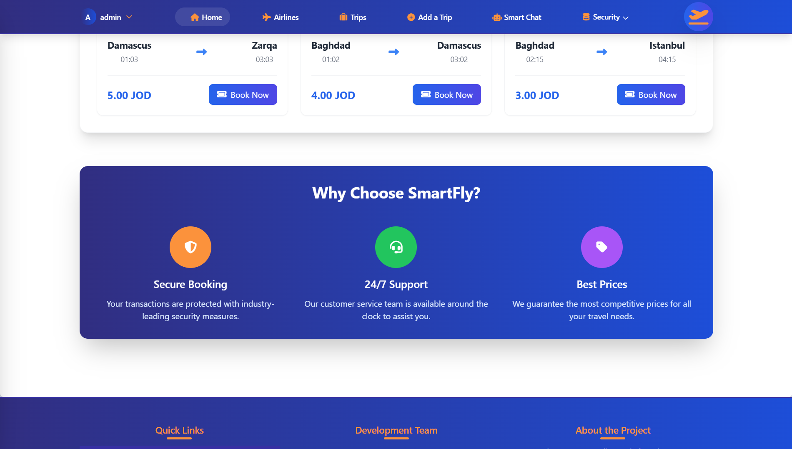
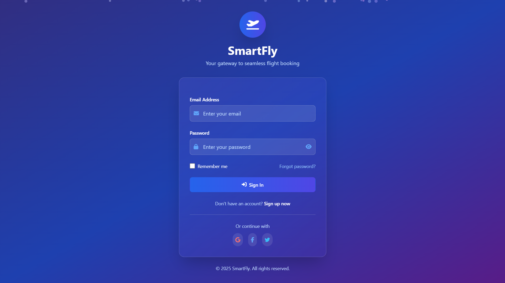
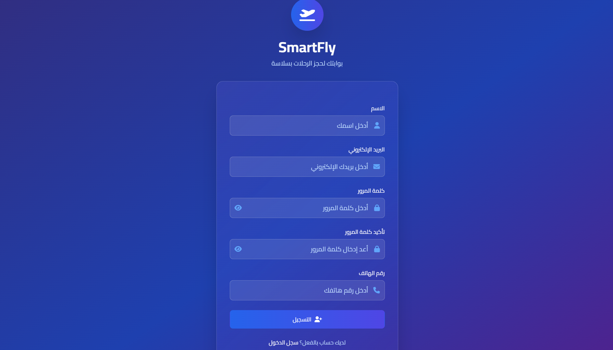
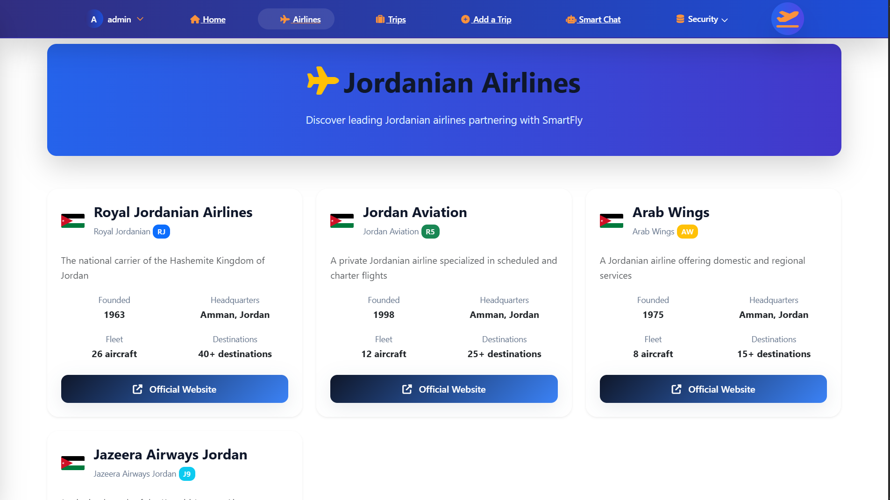
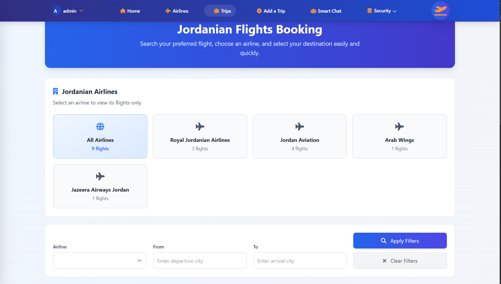

 

# ✈️ SmartFly
### Intelligent Flight Booking & Travel Assistance Platform

**Laravel · PHP · MySQL · Tailwind CSS · JavaScript · AI Integration**

**Developed during the Build with AI Hackathon 2025** 

*A web platform exploring smarter flight booking, travel management, and AI-powered assistance.*

---

## 📖 Overview

**SmartFly** is a web-based flight booking and travel assistance platform developed during the **Build with AI Hackathon 2025**.

The project explores how flight information, booking management, and AI-powered travel assistance can be brought together in a single application.

Built using Laravel, PHP, MySQL, and Tailwind CSS, SmartFly combines traditional web application functionality with an AI assistant designed to help users find relevant travel information.

The project focuses on three main areas:

- **Flight Discovery:** Exploring available flights and airline information through a unified interface.
- **Booking Management:** Providing workflows for selecting and managing flight reservations.
- **AI Travel Assistance:** Helping users with travel-related questions through an integrated AI chatbot.

---

## 🚀 Key Features

### ✈️ Flight & Airline Management

- Airline and flight information management.
- Flight browsing and search interfaces.
- Administrative functionality for managing flight records.
- Structured flight and trip information.

### 🎫 Booking System

- Flight selection and reservation workflows.
- User authentication and account management.
- Booking-related forms and interfaces.
- Trip and reservation information management.

### 🤖 AI Travel Assistant

SmartFly includes an AI-powered chatbot integrated with external AI services.

The assistant is designed to help users with common travel-related questions, including:

- Baggage information.
- Check-in guidance.
- General travel recommendations.
- Airline and flight-related questions.

The project explores a hybrid assistance approach, combining predefined information with AI-generated responses for more flexible conversations.

### 🛡️ Authentication & Authorization

The platform includes authentication and role-based access control to distinguish between regular users and administrative functionality.

### 📱 Responsive User Interface

The application uses Tailwind CSS and JavaScript to provide responsive layouts, interactive components, and asynchronous user interactions.

---

## ⚙️ Technical Overview

SmartFly is developed as a Laravel web application with a MySQL relational database.

Laravel handles the application's backend responsibilities, including business logic, database interactions, authentication, authorization, and integration with external services.

### Backend Development

Key backend technologies and concepts include:

- PHP and Laravel.
- MVC Architecture.
- Eloquent ORM.
- Database Migrations.
- Authentication and Middleware.
- Role-Based Access Control.
- Form Validation.
- External API Integration.

### AI Integration

The application integrates an AI assistant using Google's Gemini API.

The Laravel backend acts as the integration layer between the application's interface and the external AI service.

This allows AI functionality to be incorporated into the existing application without requiring a separate machine learning model to be developed or trained.

### Frontend Development

The frontend uses:

- Blade Templates.
- HTML and CSS.
- Tailwind CSS.
- JavaScript.
- AJAX.

These technologies support responsive pages, interactive forms, and dynamic application features.

---

## 🛠️ Technology Stack

| Category | Technologies |
|---|---|
| Backend | PHP, Laravel |
| Database | MySQL |
| ORM | Eloquent |
| Frontend | Blade, HTML, CSS, Tailwind CSS |
| Interactivity | JavaScript, AJAX |
| AI Integration | Google Gemini API |
| Authentication | Laravel Authentication, Middleware |
| Authorization | Role-Based Access Control |
| Architecture | Laravel MVC |

---

## 📸 Project Gallery

### 🏠 Welcome & Onboarding

  
    
  
    
  

### 🔐 Authentication

  
    
  

### ✈️ Flights & Airlines

  
    
  
    
  

### 🎫 Flight Booking

  
    
  

### 🤖 Smart AI Assistant

  
    
  

### 🛡️ Administration & Security

  

---

## 👨‍💻 My Contributions

**Abdalrhman Hamed — Full-Stack Developer**

I worked on the development of SmartFly's backend, frontend, database functionality, and AI integration.

My contributions included:

- Developed the application backend using Laravel and PHP.
- Designed and implemented database models, relationships, and migrations using MySQL and Eloquent ORM.
- Built functionality for flight management, booking workflows, and user accounts.
- Implemented authentication and role-based access control.
- Integrated an AI-powered travel assistant using an external AI API.
- Developed responsive user interfaces using Blade, Tailwind CSS, and JavaScript.
- Implemented asynchronous interactions using AJAX.
- Worked on application integration, debugging, and delivering features during the hackathon.

---

## 🏆 Hackathon

**Event:** Build with AI Hackathon 2025

SmartFly was developed as a hackathon project exploring the practical use of AI within a travel-focused web application.

The project provided an opportunity to combine full-stack development with external AI integration while working under a limited development timeline.

---

## 🔮 Future Improvements

Potential future improvements include:

- Integration with live airline and flight data providers.
- Expanded travel services such as hotels and car rentals.
- More advanced personalized travel recommendations.
- Additional booking and payment integrations.
- Improved travel analytics and reporting.

---

## 📬 Contact

**Abdalrhman Hamed — Software Engineer**

[LinkedIn](https://www.linkedin.com/in/abdalrhman-hamed-5b929725b/) · [GitHub](https://github.com/abood3omar)

---

*SmartFly — Exploring smarter travel experiences through full-stack development and AI integration.*
